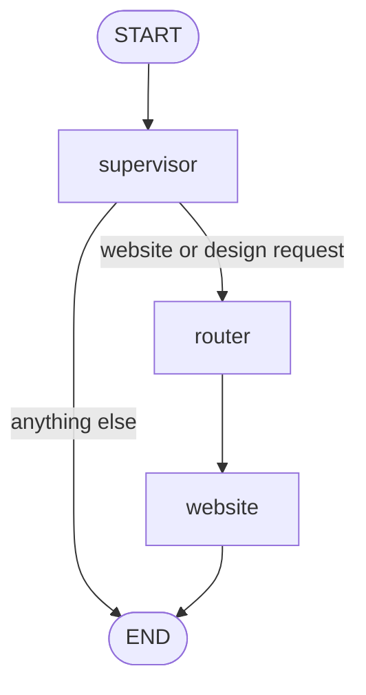

# Website agent

The website agent is a Dev Guild worker for Squarespace design. It is registered with the guild supervisor and router in this branch. A website or design request is routed to the `website` worker. The worker's structured result comes from a deterministic rule core. An optional model hook runs afterward and, in tests, uses the fake provider. The hook cannot replace the rule result unless it echoes that result.

This branch is based on `main`. It does not depend on unmerged guild workers, and it does not change the gateway or its OpenAPI contract.

The path is `supervisor` → `router` → `website`.



The supervisor decides whether the request is for this worker. The router then selects a model and records task type, cost, latency, and confidence. The website node runs the rule core and consults the provider. Tool allowlist: empty. No trading tool and no broker client.

Run it from Python:

```python
from midplane.guild.graph import run_task

result = run_task({
    "text": "Audit the Squarespace website",
    "action": "audit",
    "snapshot": {"pages": [], "seo": []},
})
```

Direct calls, without the graph:

```python
from midplane.agents.website import audit, implementation_guide, write_copy
from midplane.agents.website.schemas import CopyBrief
```

`MIDPLANE_MODEL_PROVIDER` must stay `fake`. The worker refuses `openai` and `anthropic` so a run cannot call a paid API.

## What this agent will not do

- It will not say Squarespace has a permanent free website plan. A site can be designed during a 14-day trial. Staying online on Squarespace after the trial requires Basic, Core, Plus, or Advanced.
- It will not mark a paid feature as free. Trial access is not a free plan. Mobile Start is a paid in-app plan.
- It will not change DNS, buy a plan, or sign in to Squarespace Domains. Those steps are text in the guide. `executed` is always false.
- It will not suggest real-money trading. Trading copy says paper-only.
- It will not invent metrics, customers, or awards. Copy is limited to facts in the brief.

DNS management in Squarespace Domains is free with the domain. That is not a free website.

## Knowledge base

`midplane/agents/website/data/squarespace.yaml` holds the design knowledge. Every feature names the paid plan tiers that include it (`basic`, `core`, `plus`, `advanced`). `free` is false on every feature.

| Group | What it records |
| --- | --- |
| Sections | hero, text, image, gallery, portfolio, team, FAQ, pricing, contact. Team, FAQ, pricing, and contact are composed from blocks included on every paid plan. |
| Layout | Fluid Engine: 24 columns on desktop, 8 on mobile, separate mobile positions. Section height is the row count. Spacing is section padding and the gutter. |
| Type and color | Site styles for one heading font and one paragraph font, and a site-wide palette. The audit cap is two font families. |
| Mobile and SEO | Separate mobile layout, page title, meta description, URL slug, alt text, social sharing image. The 40px mobile hero cap is this agent's readability rule, not a Squarespace limit. |
| Structure | home, about, platform, contact. |
| Higher tiers | Code injection, JavaScript and iframe blocks, and the announcement bar start at Core. Custom CSS is on Basic and above. The guide does not use the Core-only features. |
| Domain | Squarespace Domains DNS management. `free_with_domain: true`, `requires_website_plan: false`, `free: false`. |

Plan names follow Squarespace Help, "Choose the right Squarespace plan" (updated 2026-11-25). Dollar prices are omitted because Squarespace changes them.

## Audit

`audit(site_snapshot)` reads pages, sections, styles, SEO fields, and image alt text. Each finding has a severity (`info`, `warn`, or `block`), a concrete recommendation, and the affected page and section when the rule is scoped to one.

| Rule | Fires when |
| --- | --- |
| `missing_title` | SEO title is missing or blank |
| `missing_meta_description` | Meta description is missing or blank |
| `title_length` | Title is outside 20–60 characters |
| `missing_alt_text` | An image has no alt text |
| `low_contrast` | A color pair is below WCAG AA: 4.5:1 for normal text, 3:1 for large text |
| `too_many_fonts` | More than two font families |
| `missing_contact_or_cta` | No contact page or contact section, or no call to action |
| `oversized_hero_text` | A hero's mobile type is over 40px |
| `missing_pages` | home, about, platform, or contact is absent |

Contrast uses the WCAG relative-luminance formula for sRGB. Black on white is 21:1.

## Copy

`write_copy(page, brief)` writes a heading, body, and optional call to action for each requested section. The voice is the company's: Dejavú Intelligent Machines, the mid-plane, and only the sentences supplied in the brief.

`validate_copy` rejects the page when:

- a number in the copy is not a number in the brief (`140` does not authorize `14` or `40`)
- a banned hype word appears (`revolutionary`, `groundbreaking`, `guaranteed`, and the rest of the list in the knowledge base)
- a customer, client, award, or revenue claim is not in the brief
- trading language is missing `paper-only`, or it suggests real-money trading (`live trading`, `real money`, and the rest of that list)

Length limits live in `copy_limits` and differ by section type. A fact that does not fit is dropped whole. It is not cut mid-number.

## Implementation guide

`implementation_guide("build" | "refine")` returns ordered steps for déjàvuintelligentmachines.com.

- A step that needs a paid Squarespace plan sets `requires_paid_plan: true` and the note `Ask the owner first.`
- A step that would change live DNS sets `changes_live_dns: true`, requires owner approval, and says the agent does not change DNS.
- Designing in the 14-day trial, with Basic-plan blocks, is not marked as a paid step. Keeping the Squarespace site online after the trial is.
- Pointing the domain at the in-progress GitHub Pages site (`iamlover-alt/dejavu-website`) is a live DNS change and does not require a website plan, because DNS management is free with the domain. The planned records are A records `185.199.108.153` through `185.199.111.153` and a www CNAME to `iamlover-alt.github.io`.
- Pointing the domain at Squarespace hosting needs both a paid plan and a DNS change.

The guide reads the site fixture. It does not apply the records.

## Site fixture

`midplane/agents/website/data/site_context.yaml` is the current company site:

| Fact | Value |
| --- | --- |
| Domain | déjàvuintelligentmachines.com |
| Punycode | xn--djvuintelligentmachines-54b7t.com |
| Registration | Google Workspace. The Squarespace Domains account is not activated. |
| Hosting | Free GitHub Pages build in progress, repo `iamlover-alt/dejavu-website` |
| DNS plan | Four GitHub Pages A records and www CNAME `iamlover-alt.github.io`. Not applied. |
| Brand | DV single-line monogram with circuit nodes. Cyan and violet on navy. Wordmark `DEJAVÚ / INTELLIGENT MACHINES`. |
| Topics | Unified AI platform, LangGraph mid-plane with dynamic routing, episode data flywheel, composable multi-agent systems, schema and connector integration via MCP, paper-only trading controls, observability, vision. |

## Tests

```bash
python -m pip install -e ".[dev]"
python -m pytest
```

The suite covers each audit rule with a passing and a failing snapshot, the contrast formula, the copy validator, section length limits, paid and DNS flags, the knowledge-base rule that a paid feature is not free, paper-only trading copy, router selection, and identical output across two fake-provider runs. The fake provider does not open a socket.
