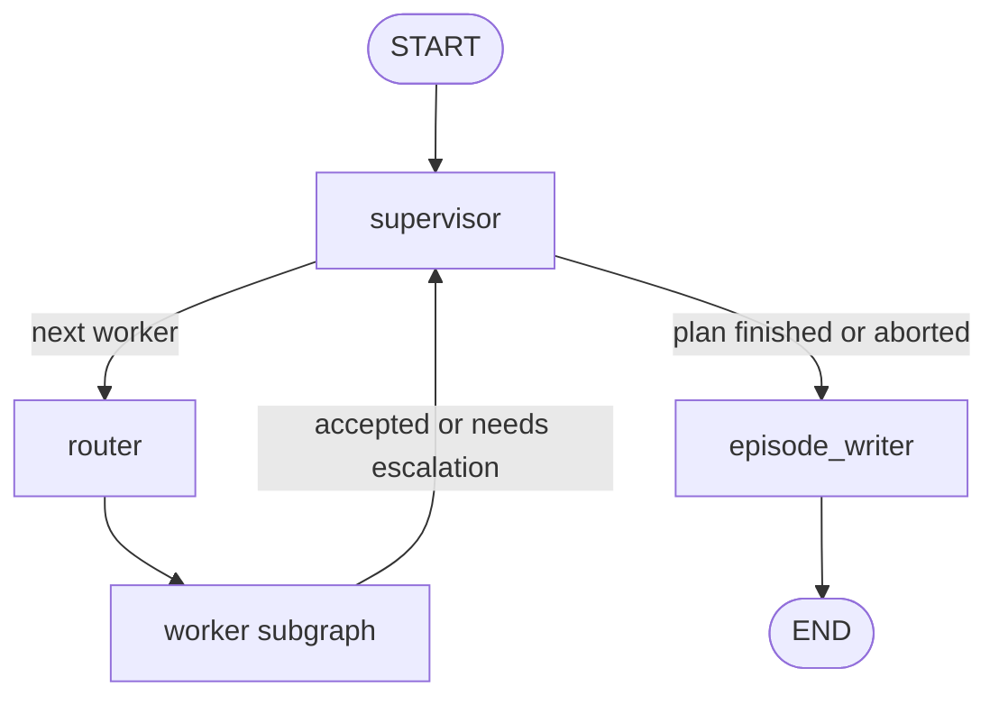

# Mid-plane architecture

The mid-plane is the persistent digital identity layer of the Unified AI Platform. It is a LangGraph runtime plus a durable episode record. Dev Guild agents, the trading system, and the iOS apps all run through it, and every run leaves an episode that can train the next one.

The [first vertical slice](first-slice.md) builds one path through this architecture. The [90-day tracker](../plan/90-day-tracker.md) is a placeholder skeleton until `dejavu_90day_plan.xlsx` is transcribed. The [README](../../README.md) is the doc map.

## Decisions

| Topic | Decision |
| --- | --- |
| Orchestrator | LangGraph hierarchical supervisor. Workers are compiled subgraphs. |
| Model selection | A router node chooses the model. Criteria are task type, cost, latency, and confidence. Failure falls back to the next model; low confidence escalates to the supervisor. |
| Run identity | `episode_writer` persists one episode per run, including failed runs. |
| Provenance | `source` is `dev_guild`, `trading`, or `app`. |
| Operational memory | A checkpointer snapshots graph state after each node so a run can resume. |
| Training memory | The `episodes` table in Postgres is the system of record for training, eval, and identity. Checkpoints may expire; episodes are the long-lived record. |
| Trading authority | A tool calls the external trading control service. That service enforces paper mode, hard limits, and the kill switch. Model confidence is only a routing signal. |
| First worker | `code_review`, specified in the [first slice](first-slice.md). |
| Slice quality score | A stub. The rubric replaces it later. |
| Observability | One trace per run, metrics aggregated from the same measurements the episode stores, and a per-run cost on the episode. |

> RECONCILE with `langgraph_nodes_pseudocode.py`
>
> RECONCILE with `langgraph_state_management.md`
>
> RECONCILE with `episode_schema.sql`

Node names, state fields, and column types in the team artifacts override the illustrative snippets below.

## Orchestration

The target graph is a supervisor loop with a shared router and a single exit that always writes the episode.



**Supervisor.** The supervisor owns the plan. It reads the task and `source`, chooses the next registered worker role, and decides when the plan is finished. With more than one role available, the supervisor may itself be a model call; that call goes through the router and is stored in `model_choices`. A plan is data on the shared state, so the episode can show why each worker ran.

**Router.** Routing is a pure function of the current step plus a versioned route table in configuration. The router writes an ordered choice and the criteria it used. It does the selection; the worker performs the model call.

Criteria, all four recorded on every choice:

| Criterion | What the router uses it for |
| --- | --- |
| Task type | Which models are eligible for this worker role |
| Cost | Remaining run budget, and the relative cost of eligible models |
| Latency | Remaining latency budget, and the relative latency of eligible models |
| Confidence | The minimum confidence the step must report to count as done |

**Fallback.** The route carries a primary model and a fallback model. The worker uses the fallback after a timeout, a provider error, or an unparseable response. Both attempts are appended to `model_choices`.

**Escalation.** The worker returns a confidence value. When that value is below the route's confidence criterion, or the step is high-impact, control returns to the supervisor with the step marked for escalation. The supervisor then re-plans: a stronger model, a different worker, or an abort. Abort still ends at `episode_writer`. Numeric thresholds and the model catalog live in configuration; this spec names the criteria and the two outcomes (fallback, then escalation) and leaves the numbers unset.

High-impact includes any request for a trading action. Escalating the model does not authorize the action. The trading control service is the only authorizer. See [Trading integration](#trading-integration).

```python
# Illustrative. langgraph_nodes_pseudocode.py wins if it already specifies this.
def choose_model(task_type: str, budget: dict, table: dict) -> dict:
    eligible = [m for m in table["models"] if task_type in m["task_types"]]
    ranked = sorted(eligible, key=lambda m: (m["cost_rank"], m["latency_rank"]))
    return {
        "task_type": task_type,
        "primary": ranked[0]["id"],
        "fallback": ranked[1]["id"] if len(ranked) > 1 else None,
        "criteria": {
            "task_type": task_type,
            "cost": budget["max_cost"],
            "latency": budget["max_latency_ms"],
            "confidence": budget["min_confidence"],
        },
    }
```

> RECONCILE with `langgraph_nodes_pseudocode.py`

The [first slice](first-slice.md) is a single pass: `supervisor` → `router` → `code_review` → `episode_writer`. Fallback is in that slice. The supervisor re-plan loop is the target architecture and follows the slice.

## Shared state and checkpoints

One typed state object travels through the graph. Append-only fields (model choices, tool calls, trace events) use reducers so nodes add events instead of overwriting each other's history.

Two identifiers stay distinct:

| Id | Role |
| --- | --- |
| `thread_id` | Checkpoint key. Resume and debug use it. |
| `run_id` | Episode key. One run, one episode. A retry of the same run upserts that episode. |

**Decision:** checkpoint after every node. Checkpoints are operational. The episode written at the end stores the inputs, plan, tool calls, model choices, outputs, cost, latency, outcome, quality score, and full trace, so training and audit stand on `episodes` after a checkpoint has expired.

The checkpointer implementation and the frozen field list are already specified by the team.

> RECONCILE with `langgraph_state_management.md`

Slice default, used only when that document does not name a backend: the LangGraph Postgres checkpointer, in the same database as `episodes`, keyed by `thread_id`.

An illustrative state shape for review is in the [first slice](first-slice.md#state-fields). Field names freeze at reconciliation, not here.

## Episode data flywheel

`episode_writer` runs once at the end of every graph run, on the success path and on the failure path. A run that errors still trains the loop: the failure is the record.

Each episode carries:

| Field | Contents |
| --- | --- |
| Inputs | The task that entered the graph |
| Plan | The supervisor's plan |
| Tool calls | Ordered tool name, arguments, and result summary |
| Model choices | Every router decision and model attempt, including fallbacks |
| Outputs | The workers' structured results |
| Cost and latency | Totals for the run, from the same counters observability uses |
| Outcome | `success` or `error` for the slice. Later outcomes, if the schema adds them, follow the schema |
| Quality score | Rubric output. The slice writes a stub |
| Provenance | `source`: `dev_guild`, `trading`, or `app` |
| Trace | The full ordered trace of the run |

```json
{
  "run_id": "00000000-0000-0000-0000-000000000000",
  "source": "dev_guild",
  "inputs": {},
  "plan": {},
  "tool_calls": [],
  "model_choices": [],
  "outputs": {},
  "cost": {},
  "latency_ms": 0,
  "outcome": "success",
  "quality_score": 0.5,
  "trace": []
}
```

That JSON is a field checklist. `episode_example.json` is the payload of record.

> RECONCILE with `episode_schema.sql`
>
> RECONCILE with `episode_example.json`

### Quality scoring

Scoring is three layers. The slice ships layer 1 only.

1. **Completeness (slice stub).** Required fields are present, the trace lists every node that ran, `outcome` agrees with `error`, and the worker output is non-empty. When those checks pass, the stub writes `0.5`. When they fail, or `outcome` is `error`, the stub writes `0.0`. The value `1.0` is reserved for the real rubric, so a stubbed row stays obvious.
2. **Task rubric.** Role-specific checks. For `code_review`, findings have to cite the input under review. Rubric text comes from the guild prompts once those prompts define done-ness for a role.
3. **Judge model.** A later evaluator writes `quality_score` and stores its reasoning with the score. The judge's own run is its own episode. The column that holds the reasoning follows the episode schema.

> RECONCILE with `episode_schema.sql` for the score's type and scale. If the column is not a float in `[0, 1]`, the stub function changes and the reserved `1.0` convention changes with it.
>
> RECONCILE with `dev_guild_prompt_templates.md` for rubric text.

### From episodes to training and eval data

`episodes` stays the system of record. A later export job, outside the first slice, reads it and writes versioned datasets.

- The export keeps failed and low-scoring episodes in the corpus. They are the negative and preference examples. A quality bar selects the supervised-training subset.
- Datasets are partitioned by `source`. `dev_guild` episodes improve engineering agents. `trading` episodes improve research behavior only while the trading control service is enforcing paper mode. `app` episodes improve the product assistants behind the iOS apps.
- Every export records the `run_id` set it consumed.
- The eval split is a frozen, disjoint set of `run_id`s. Those runs stay out of later training exports. The split rule (by time or by hash of `run_id`) is an open question; no team artifact listed for this spec is known here to already define it.

Closed loop means the same identity layer that served the run supplies the next training set. Export provenance points back at episode `run_id`s, so a dataset can be rebuilt after the schema is reconciled.

## Dev Guild workers

A Dev Guild role is a worker subgraph registered with the supervisor. The supervisor selects a role. The router selects a model. The worker executes. `episode_writer` is the only node that writes an episode. Workers append to shared state and return.

Registration is data:

```python
# Illustrative registry entry. Role ids and prompts come from the templates.
WorkerSpec = {
    "role_id": "code_review",
    "task_type": "code_review",   # router eligibility key
    "tools": [],                  # allowlist; empty in the first slice
    "prompt_ref": "code_review",  # key into the prompt templates
}
```

Adding a guild role means adding a `WorkerSpec` and a compiled subgraph. `episode_writer`, the episode schema, and the iOS surface stay as they are.

The canonical role list and the prompt text already exist.

> RECONCILE with `dev_guild_prompt_templates.md`

This spec fixes the plug-in contract and names the first role, `code_review`. It does not restate prompts. Guild runs set `source` to `dev_guild`. The episode records the run; a review or a patch is the work product, stored by whatever system the guild already uses, and referenced from the episode output.

Worker tools are an allowlist on the `WorkerSpec`. Broker clients are not a tool any worker may list. The trading tool, when a later slice adds it, is a client of the trading control service and nothing else. See [Trading integration](#trading-integration).

## Trading integration

The trading bot funds the platform. The mid-plane's job is to keep trading authority outside the model.

**Decision:** an agent that needs a trading action calls one tool. That tool calls the external trading control service. The service applies paper mode, hard position and loss limits, and the kill switch. Those checks run in the service, outside the LLM, on every call. Paper mode is the enforced regime now. A real-money path exists only when that service, under its own hard controls, accepts the action.

```text
worker -- tool --> trading control service
                      |-- paper mode (enforced here)
                      |-- hard limits (enforced here)
                      |-- kill switch (enforced here)
                   broker credentials and broker APIs stay inside the service
```

Consequences for the graph:

- Graphs do not embed broker SDKs, broker keys, or exchange URLs.
- The model never decides that a limit, the kill switch, or paper mode is satisfied. The service returns allow or deny. The episode records the tool call and that result.
- A denied or killed action is a normal tool result. The run still ends in `episode_writer` with `source` `trading`.
- Skeptic Lab owns trading research, and that research stays paper-only until the control service says otherwise. See the [tracker](../plan/90-day-tracker.md).

The service contract, the limit values, and the kill-switch semantics are already written down.

> RECONCILE with `trading_control_service_spec.md`
>
> RECONCILE with `trading_risk_mitigation.md`
>
> RECONCILE with `risk_register.md`

The first slice does not register the trading tool. Acceptance tests for the slice assert the tool allowlist has no trading or broker tool, so the boundary is true on day one and stays true when the tool is added.

## Observability

Operators and the episode store see the same run.

- **Traces.** One root span per run, a child span per node, and child spans per model call and tool call. Attributes include `run_id`, `thread_id`, `source`, role, and model id. `episode_writer` persists the ordered events as the episode trace, so the training record survives the tracing backend's retention.
- **Metrics.** Counters and histograms for run count, run latency, run cost, model-call count, tool errors, escalations, and quality score. Labels are `source`, role, and outcome where the measurement has them.
- **Per-run cost.** The worker accumulates token counts and a monetary total when the provider reports a price. `episode_writer` stores that total on the episode. The run-cost metric for that `run_id` is the same number.

Illustrative metric names, so dashboards and tests have a target: `midplane_run_total`, `midplane_run_latency_ms`, `midplane_run_cost`, `midplane_model_call_total`, `midplane_tool_error_total`, `midplane_escalation_total`, `midplane_quality_score`.

> RECONCILE with `integration_guide.md` if it already names the collector, the span schema, or the metric names.
>
> RECONCILE with `episode_example.json` for the on-episode trace shape.

## iOS integration surface

iOS apps are product surfaces on the mid-plane. They create a run and read its identity back. They do not embed the supervisor, the router, or a model SDK, and they do not carry broker credentials.

The surface is three operations:

| Operation | Behavior |
| --- | --- |
| Create run | Accepts a task and returns `run_id`. The server sets `source` to `app`. The client does not choose the model or the tool allowlist. |
| Get run status | Reads progress from the checkpoint / run record for that `run_id`. |
| Get episode | Returns the episode after `episode_writer` has committed it. This is the persistent identity the app can show across launches. |

Transport, authentication, pagination, and whether the client polls or receives a push are already in the integration guide.

> RECONCILE with `integration_guide.md`

Until that reconciliation, the architectural commitment is the three operations and the rule that `source=app` runs are ordinary graph runs: same supervisor, same router, same episode writer.

## Open questions

Questions the named artifacts are expected to close. Do not answer them by expanding the illustrative snippets.

| # | Question | Where the answer should come from |
| --- | --- | --- |
| 1 | Frozen state fields, reducers, and checkpointer backend | `langgraph_state_management.md` |
| 2 | Node-level control flow where it differs from the loop in this doc | `langgraph_nodes_pseudocode.py` |
| 3 | `episodes` columns, types, uniqueness, and the example payload | `episode_schema.sql`, `episode_example.json` |
| 4 | Quality-score scale, and where judge reasoning is stored | `episode_schema.sql` |
| 5 | Canonical guild roles and prompt text | `dev_guild_prompt_templates.md` |
| 6 | Trading control API, limit values, paper-mode flag, kill switch | `trading_control_service_spec.md`, `trading_risk_mitigation.md` |
| 7 | Which risks block any real-money path | `risk_register.md` |
| 8 | iOS auth, payloads, and status delivery | `integration_guide.md` |
| 9 | Milestone dates, order, owners, and exit criteria | `dejavu_90day_plan.xlsx` |

Questions none of those artifacts are known to answer. Platform Architect owns the resolution:

| # | Question |
| --- | --- |
| 10 | The model catalog and the numeric cost, latency, and confidence thresholds |
| 11 | Train/eval split rule: time-based or hash of `run_id` |
| 12 | Episode retention and what is stripped before an episode is exported |
| 13 | Tracing collector, if `integration_guide.md` does not name one |
| 14 | Whether a human must accept an episode into a training export, or a quality bar is sufficient |

## Related documents

- [README](../../README.md)
- [First vertical slice](first-slice.md)
- [90-day tracker](../plan/90-day-tracker.md)
